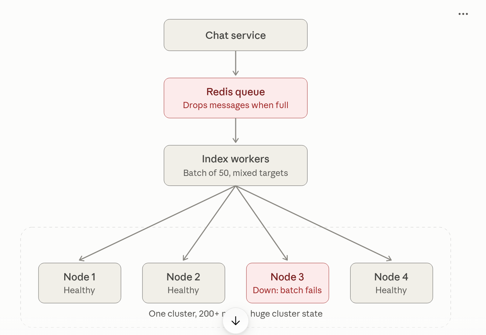
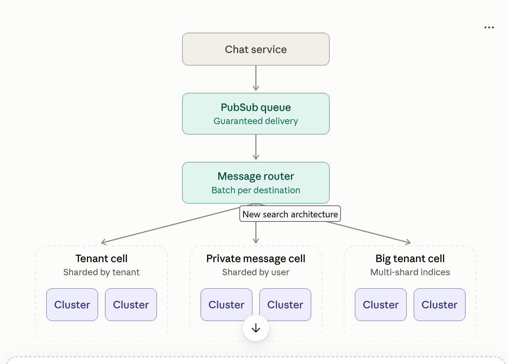

# Interview Q&A (Extended): Rebuilding a Large-Scale Message Search System

**Role:** Senior Python Developer / Solutions Architect
**Topic:** Scaling a search platform from billions to trillions of messages using Elasticsearch, Kubernetes and a message queue

---

## Part 1: Project overview

### Q1. Tell me about a challenging project you worked on.

I worked on rebuilding the message search system for a large chat platform. Users could search their message history, and behind the scenes we used Elasticsearch. The first version was designed years earlier to handle billions of messages and it did that well. Our goals back then were to be fast, cost-effective, scalable and easy to operate.

As the platform grew, cracks started to show. Our queue was dropping messages, one failed node could break a large share of indexing work, our clusters were so big that upgrades were frightening, and our biggest tenants were hitting a hard limit in the storage engine. We were having more and more incidents, and the old design couldn't keep up with the growth in message volume and query volume.

So we planned a full redesign. It was a large undertaking, so we also used it as a chance to fix old limitations and add features that users had been asking for.

**Follow-up: What was your specific role?**

I owned the indexing pipeline, which is the part that takes new messages from the queue and writes them into the right Elasticsearch cluster and index. That included the message router, the batching strategy, the retry and acknowledgement behaviour, and the migration tooling for moving data between indices. I worked closely with the infrastructure team, who owned the Kubernetes and Elasticsearch operator side.

**Follow-up: How did you decide a rewrite was justified and not just more patching?**

I looked at the pattern of incidents. Every incident was a different symptom, but they had the same causes: a queue that couldn't absorb backlogs, a fan-out design where one failure spread widely, and clusters too big to operate safely. Patching each symptom would have kept us in a cycle of firefighting. We also had a hard limit coming that no patch could remove, so a redesign was the only responsible path. I wrote a short design doc listing each failure, its root cause, and how the new design removed it, and that made it easy to get agreement.

---

## Part 2: The queue problem

### Q2. What was the first big problem you faced?

Our real-time indexing queue was built on Redis. It held up well at first. But whenever Elasticsearch had a problem, which happened often when a node failed, the queue started to back up. Redis kept everything in memory and a growing queue meant more CPU, and eventually the Redis cluster became the point of failure. Once CPU maxed out it began dropping messages. That meant messages never got indexed and users couldn't find them in search.

I replaced Redis with a managed message queue (a PubSub system). It gives guaranteed, at-least-once delivery and can hold very large backlogs on disk. After the change, an Elasticsearch failure only slows indexing down. Messages wait in the queue and get processed once the cluster recovers. Nothing is dropped.

**Follow-up: At-least-once delivery means duplicates. How did you handle that?**

Good question. We made the indexing operation idempotent. Each message is indexed using its unique message ID as the document ID. If the same message is delivered twice, the second write simply overwrites the first with the same content. So duplicates are harmless and we never needed exactly-once delivery, which is much harder and more expensive.

**Follow-up: When do you acknowledge a message?**

Only after Elasticsearch confirms the bulk write succeeded. If the worker crashes before acknowledging, the queue redelivers the message after the ack deadline. That's the whole reason we don't lose data. If acknowledgement happened earlier, a crash would silently lose messages and we'd be back to the original problem.

**Follow-up: Why not Kafka?**

Kafka would also work and is a strong choice. We already ran the managed PubSub service and it gave us what we needed without extra operational work, mainly guaranteed delivery and no capacity planning for brokers. It also turned out to be so convenient that other teams adopted it for task scheduling. If we had been starting from nothing and needed replay of old events or strict ordering per key, I would have looked harder at Kafka.

---

## Part 3: Bulk indexing and fan-out

### Q3. How did you handle failures during bulk indexing?

Elasticsearch is much faster when you send documents in bulk, so our workers pulled batches of messages from the queue. The problem was that messages in one batch belonged to different indices on different nodes. A batch of 50 messages could fan out to 50 different nodes.

Bulk operations were treated as all-or-nothing. If one node in that batch was down, the whole batch was considered failed and every message was put back on the queue to retry. The math shows how bad that is. With 100 nodes and a batch of 50 messages, the chance that a batch touches one specific failed node is:

```python
nodes = 100
batch_size = 50
p_hit_failed_node = 1 - (1 - 1 / nodes) ** batch_size
print(f"{p_hit_failed_node:.1%}")  # ~39.5%
```

So one dead node caused roughly 40% of all bulk operations to fail, and those retries made the queue backlog even worse, which pushed Redis towards its limit. It was a cascading failure.

The fix was to make workers smarter about batching. I built a message router that reads messages from the queue, works out each message's destination (the cluster and index it belongs to), and collects batches per destination. Each bulk request now talks to exactly one index on one node. If a node fails, only the batches for that node fail, and everything else keeps flowing.

**Follow-up: Can you show how you would build that router in Python?**

Yes. In our production system it was written in Rust with Tokio, but the same design maps cleanly to Python's `asyncio`. Here is a simplified version. Each destination gets its own queue and its own worker task. Workers flush when the batch is full or when a timer expires, whichever comes first.

```python
import asyncio
from dataclasses import dataclass
from typing import Awaitable, Callable, Hashable

@dataclass
class Item:
    payload: dict
    ack: Callable[[], None]
    nack: Callable[[], None]

class MessageRouter:
    def __init__(
        self,
        bulk_index: Callable[[Hashable, list[dict]], Awaitable[None]],
        batch_size: int = 500,
        flush_interval: float = 1.0,
        max_queue: int = 10_000,
    ):
        self._bulk_index = bulk_index
        self._batch_size = batch_size
        self._flush_interval = flush_interval
        self._max_queue = max_queue
        self._queues: dict[Hashable, asyncio.Queue[Item]] = {}
        self._tasks: dict[Hashable, asyncio.Task] = {}

    async def send(self, destination: Hashable, item: Item) -> None:
        queue = self._queues.get(destination)
        if queue is None:
            queue = asyncio.Queue(maxsize=self._max_queue)
            self._queues[destination] = queue
            self._tasks[destination] = asyncio.create_task(
                self._worker(destination, queue)
            )
        await queue.put(item)  # blocks when full -> backpressure

    async def _worker(self, destination, queue: asyncio.Queue) -> None:
        loop = asyncio.get_running_loop()
        while True:
            batch = [await queue.get()]
            deadline = loop.time() + self._flush_interval
            while len(batch) < self._batch_size:
                timeout = deadline - loop.time()
                if timeout <= 0:
                    break
                try:
                    batch.append(await asyncio.wait_for(queue.get(), timeout))
                except asyncio.TimeoutError:
                    break
            await self._flush(destination, batch)

    async def _flush(self, destination, batch: list[Item]) -> None:
        try:
            await self._bulk_index(destination, [i.payload for i in batch])
        except Exception:
            for item in batch:
                item.nack()   # queue will redeliver
        else:
            for item in batch:
                item.ack()    # safe to acknowledge now
```

The `destination` key would be something like `(cluster_name, index_name)`.

**Follow-up: What would you improve in that code before production?**

A few things:

- **Idle cleanup.** Destinations that stay quiet should have their task and queue removed so memory doesn't grow forever.
- **Partial failures.** Elasticsearch bulk responses report success or failure per document. I would ack the successes and nack only the failures instead of nacking the whole batch.
- **Retries with backoff and jitter** for temporary errors, and a dead-letter queue for messages that keep failing.
- **Graceful shutdown** that drains queues and flushes in-flight batches.
- **Metrics** for batch size, flush latency, queue depth and failure rate per destination.

**Follow-up: Your queues are bounded. Why does that matter?**

An unbounded queue hides problems. If one destination is slow or down, its queue grows without limit and eventually the process runs out of memory, taking healthy destinations down with it. A bounded queue forces `send()` to wait, which applies backpressure to the consumer. The consumer then stops pulling from PubSub, and messages safely stay in the durable queue instead of in my process memory. The failure stays contained.

**Follow-up: Is asyncio enough, or would you use multiprocessing?**

The work is mostly waiting on network calls, which is what `asyncio` is good at. One process can manage thousands of destinations. I would only add more processes to use more CPU cores or for fault isolation. In that case I would run several worker processes, each consuming from the same PubSub subscription, and let the queue spread the load. I would not share routing state between processes.

---

## Part 4: Cluster size, Kubernetes and cells

### Q4. What was hard about scaling the system?

As message volume grew, we scaled by adding more nodes and more indices to the same clusters. That worked at first, but we ended up with clusters of more than 200 nodes and terabytes of data. Three things went wrong:

1. **Cluster state doesn't scale.** In Elasticsearch, every cluster has a cluster state that the master node maintains. As nodes and indices grow, this state grows, and the master's overhead grows with it. Our master nodes started running out of memory, which caused indexing failures, query timeouts and a growing backlog.
2. **More nodes means more failures.** With 200 nodes, something is almost always failing.
3. **Fan-out grows.** Operations touched more indices and nodes, which slowed everything down.

We decided to run many smaller clusters instead of one huge one. We introduced the idea of a **cell**: a logical group of several small Elasticsearch clusters. Inside each cluster we use dedicated node roles:

- **Master-eligible nodes** only coordinate the cluster, so they always have enough resources.
- **Ingest nodes** handle pre-processing and routing. They hold no data, so they run as a stateless deployment and scale up and down with traffic.
- **Data nodes** get plenty of heap for indexing and queries.

We also followed the guideline of keeping each index to about 200 million documents and 50 GB, creating more indices and spreading them over more, smaller clusters.

**Follow-up: How did you make each cluster resilient to a zone outage?**

We spread everything across three availability zones: three master-eligible nodes (one per zone), at least three ingest nodes (one per zone), and for data nodes we used shard allocation awareness so that an index's primary shard and its replica always land in different zones. We also turned on forced awareness so shards are balanced across all zones, and the cluster doesn't pile everything into the surviving zones during a failure and overload them.

**Follow-up: Why Kubernetes for a stateful system? That's usually discouraged.**

It's a fair concern, because stateful workloads are harder than stateless ones. We had already moved most stateless services to Kubernetes and saw a big improvement in operability and cost control. For Elasticsearch, we used the official Elasticsearch operator, which understands the database: it knows how to do rolling restarts safely, wait for shards to be healthy between steps, and handle upgrades. That removed most of the manual work. We kept data on persistent volumes and ran each node role on a different node pool with the right machine type. I would still say Kubernetes is only a good idea for stateful systems when you have a good operator and a team that understands storage.

**Follow-up: How do you decide how many clusters and how big?**

I start with the constraints: the 200M documents / 50 GB per index guideline, the number of shards a master can manage comfortably, and the blast radius I'm willing to accept if a cluster fails. Then I size clusters so that losing one affects a small, acceptable share of users. It is a trade-off between operational overhead (more clusters to manage) and risk (fewer, bigger clusters fail worse). Cells gave us a clean way to add capacity: add a cluster to the cell rather than grow an existing one.

---

## Part 5: Upgrades and security

### Q5. How did you deal with upgrades and security patches?

Before the redesign this was the most painful area. Because losing a single node hurt so much, we had no safe way to do rolling restarts. Draining nodes before a restart would have taken prohibitively long because the clusters were so large. As a result we were stuck on old operating system versions and old Elasticsearch versions, missing both security fixes and performance improvements.

The clearest example was the log4shell vulnerability. The fix required restarting every Elasticsearch node with a new configuration, and we had to take the whole search system offline for a maintenance window to do it.

After moving to Kubernetes with the operator, upgrades and restarts are automatic and we do them with no service impact. The operator restarts nodes one at a time, waits for the cluster to return to a healthy state, and then continues. Because each cluster is small and replicas live in different zones, losing a node during a restart doesn't affect users.

**Follow-up: How do you make sure a rolling restart is actually safe?**

A few safeguards:

- Every index has at least one replica in another zone.
- Pod disruption budgets limit how many nodes can be down at once.
- Readiness checks wait for the cluster to be green before the next node is touched.
- We test upgrades first on a smaller cell, and watch indexing lag and query latency during the roll.
- The indexing pipeline tolerates a temporary slowdown because the queue absorbs the backlog.

**Follow-up: What would you do differently for a zero-day like log4shell now?**

I'd have a tested, automated path to roll a config or image change across all clusters in hours, not a maintenance window. And I'd keep clusters on supported versions as routine, so a security fix is one more rolling change, not a risky jump over several versions.

---

## Part 6: Very large tenants

### Q6. What happened when some tenants got too big?

Every Elasticsearch index is a single Lucene index under the hood, and Lucene has a hard limit of about 2 billion documents per index. When a very large tenant (we called them "big freaking" tenants, or BFTs) reached it, every indexing operation on that index failed.

The only recovery we had at the time was to work with our Safety team to find tenants that existed only to spam messages and delete them. That worked for a while, but we knew real communities would eventually exceed 2 billion legitimate messages.

We normally create indices with a **single primary shard**. That is intentional: all of a tenant's data lives on one node, so a query doesn't fan out and there is no coordination overhead. For almost all tenants, that gives the fastest queries.

For very large tenants the trade-off flips. They have billions of messages, so spreading the index across several primary shards lets queries run in parallel, and the coordination cost is worth it. More shards also raises the document ceiling, because each shard is its own Lucene index. We gave these tenants dedicated Elasticsearch clusters and indices with multiple primary shards. A side benefit: normal tenants that used to share an index with a giant tenant no longer suffer from its expensive queries.

**Follow-up: Why not use multiple shards for everyone?**

Because it makes the common case slower. Multiple shards mean every query must be sent to every shard and the results merged. For a small tenant that's pure overhead. Single-shard indices are simpler, faster and cheaper for 99% of users, so I'd keep that default and handle the outliers separately.

**Follow-up: How do you detect that a tenant is approaching the limit?**

We track document counts per index and alert well before the limit, for example at 60-70%. A scheduled job flags candidates and starts the migration process. Waiting until the limit is hit is too late, since indexing stops immediately.

---

## Part 7: Zero-downtime migration

### Q7. How did you migrate a huge tenant without breaking search?

We built a migration flow that keeps indexing and serving queries the whole time:

1. **Identify** a tenant approaching the document limit. It lives on `index-a`.
2. **Create** a new index in the dedicated cell with more primary shards.
3. **Dual-write.** New messages are indexed to both `index-a` and the new index.
4. **Backfill.** A job copies all historical messages into the new index. Searches are still served from `index-a`.
5. **Cut over.** When the backfill is complete, we switch new query traffic to the new index.
6. **Verify and clean up.** Once we trust the new index, we stop writing to `index-a` and run a cleanup job to remove that tenant's messages from it.

A simplified version of the control logic looks like this:

```python
from enum import Enum

class Phase(Enum):
    NORMAL = "normal"
    DUAL_WRITE = "dual_write"
    BACKFILLING = "backfilling"
    CUTOVER = "cutover"
    CLEANUP = "cleanup"

def write_targets(tenant) -> list[str]:
    if tenant.phase in (Phase.DUAL_WRITE, Phase.BACKFILLING, Phase.CUTOVER):
        return [tenant.old_index, tenant.new_index]
    return [tenant.current_index]

def read_target(tenant) -> str:
    if tenant.phase in (Phase.CUTOVER, Phase.CLEANUP):
        return tenant.new_index
    return tenant.old_index
```

The tenant's migration phase is stored in a shared config store so every indexing worker and query service sees the same state.

**Follow-up: What about messages that arrive during the backfill?**

That's the reason dual-write starts before the backfill. Any message that arrives after dual-write begins goes to both indices, and the backfill only needs to copy what was there before. Since indexing is idempotent by message ID, any overlap between the two is harmless.

**Follow-up: How do you know the new index is correct before cutting over?**

We compare document counts between old and new, run sample queries against both and diff the results, and watch error rates and latency on a small slice of traffic first if we can. We only stop writing to the old index after we've been confident for some time. Keeping the old index available gives us a fast rollback.

**Follow-up: What if the backfill job fails halfway?**

The job processes data in chunks and records progress (for example, the last message ID copied). If it fails, it resumes from the checkpoint. Because writes are idempotent, re-copying a chunk is safe.

---

## Part 8: New product capability

### Q8. Did you add anything new for users, or only fix problems?

Yes. Users had wanted to search across all of their private messages for years, but we couldn't offer it. All messages were sharded by tenant or by conversation, so searching every private conversation a user has would mean fanning out a query to a huge number of indices. That would have been far too expensive.

To make it efficient, the data has to be organized by **user**: all of one user's private messages stored together on one index. The cost is that each private message is stored twice, once in each participant's index. We accepted that, because we were already planning to re-index everything. So it was a rare chance to shard some messages differently without a second migration.

Now there are two cells: one for tenant messages, sharded by tenant ID, and one for private messages, sharded by user ID. Cross-conversation search is just a single-index query on the user's shard.

**Follow-up: Isn't doubling storage wasteful?**

It's a deliberate trade of storage for query speed. Storage is cheap compared to the cost and latency of fan-out queries. Private messages are also a smaller share of total volume, so the doubling applies to a limited slice of data. I would make a different choice if storage were the scarce resource.

**Follow-up: How do you keep the two copies consistent?**

Each copy is written from the same source event, so the router sends it to two destinations. If one write fails, only that destination's batch is retried. Because writes are idempotent, the retry just brings that copy up to date. For edits and deletes, the same event is applied to both copies. I'd also run a periodic reconciliation job to catch any drift.

---

## Part 9: Results and trade-offs

### Q9. What were the results?

- We index **trillions** of messages, with **double the indexing throughput** compared with the old system.
- **Median query latency** dropped from about 500 ms to under 100 ms.
- **p99 latency** improved from about 1 s to under 500 ms.
- We run **40 Elasticsearch clusters** with thousands of indices.
- Upgrades and rolling restarts are **automatic with no service impact**.

**Follow-up: What trade-offs did you accept?**

- **More clusters to manage**, which we offset with the operator and automation.
- **More storage** for private messages.
- **Higher design complexity**, such as routing by destination and the multi-phase migration for large tenants.
- **Slightly slower indexing during failures**, because the queue absorbs backlogs instead of dropping work. We chose that on purpose: slow is recoverable, lost data is not.

**Follow-up: How did you measure success?**

Before the project, we agreed on metrics: indexing lag, message loss rate (target zero), query p50 and p99 latency, error rates, and the number of search-related incidents. We tracked them before and after the cutover, and we could also show that upgrades no longer needed a maintenance window.

---

## Part 10: Lessons and reflection

### Q10. What did you learn from this?

- **Big systems fail in surprising ways.** A choice that looks like a pure optimization, such as large mixed batches, can turn one failure into dozens.
- **Smaller, isolated pieces are easier to run.** A limited blast radius is worth the added number of components.
- **Make failure slow, not lossy.** Durable queues, idempotent writes and acknowledgement after success mean the system degrades gracefully.
- **A big rebuild is an opportunity.** We fixed old limits and shipped a long-requested feature because we were already touching all the data.
- **Plan for the outliers.** Defaults should serve the majority, and special cases deserve their own path instead of bending the whole system.

**Follow-up: What would you do differently?**

I'd invest earlier in observability and in automated migration tooling, since both paid off enormously once we had them. I'd also test failure scenarios (killing nodes, filling queues, slowing a cluster) regularly, so these problems show up in a drill and not in an incident.

---

## Part 11: Architect-level follow-up questions

### Q11. How would you design the system if you started from scratch today?

I'd keep the main ideas: a durable queue in front of the indexer, idempotent writes, small clusters grouped into cells, routing by a stable key, and a separate path for outliers. I'd also decide up front how data is partitioned (by tenant, by user, or both) based on the queries I need to serve, because changing it later means re-indexing everything.

### Q12. How do you handle hot tenants (a sudden spike for one customer)?

The router's per-destination queues isolate the spike: only that destination's queue grows. Bounded queues apply backpressure so the spike doesn't exhaust memory, and the durable queue holds the excess. On the query side, I'd add rate limits per tenant and caching for repeated queries. If a tenant stays hot, it becomes a candidate for the dedicated cell.

### Q13. How do you monitor and alert on this pipeline?

Key signals are queue depth and oldest-message age (indexing lag), bulk success/failure rate per destination, flush latency, Elasticsearch cluster health and heap usage, master node memory, and query latency percentiles. I'd alert on symptoms users feel (lag, latency, errors) first, and use the other metrics to diagnose.

### Q14. How would you test this system?

- **Unit tests** for routing and batching logic, using fake `bulk_index` functions that fail on demand.
- **Integration tests** against a small real Elasticsearch cluster.
- **Failure injection:** kill a node, slow a cluster, restart a worker mid-batch, and check that nothing is lost and nothing is duplicated.
- **Load tests** that replay realistic traffic.
- **Migration rehearsals** on copies of real large tenants.

### Q15. If you had to explain this project in one minute, what would you say?

"Our message search was built on one design that worked at billions of messages but broke at larger scale. A fragile queue dropped messages, large mixed batches made one node failure hit many operations, giant clusters were hard to upgrade, and our biggest customers hit a hard document limit. I redesigned it with a durable queue, a Python/async-style router that batches per destination, many small clusters on Kubernetes, dedicated multi-shard clusters for the biggest tenants, and a zero-downtime migration process. As a result, we index trillions of messages at twice the throughput, median search latency went from about 500 ms to under 100 ms, and upgrades now happen with no downtime."



